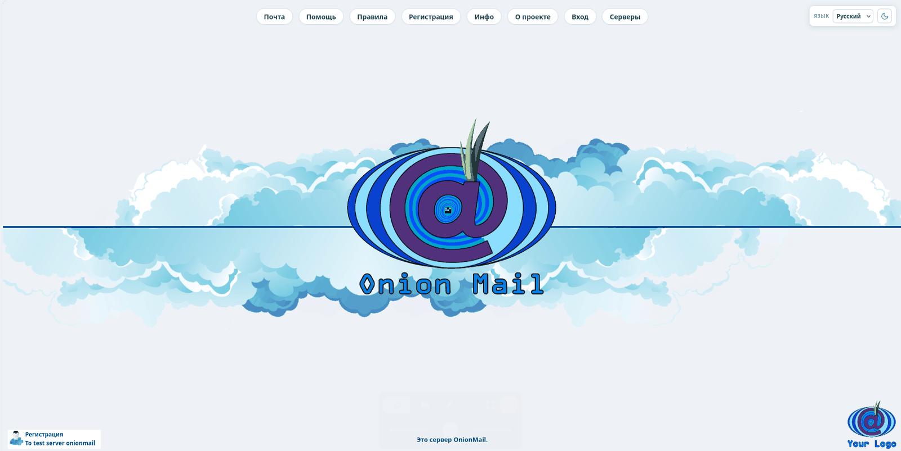
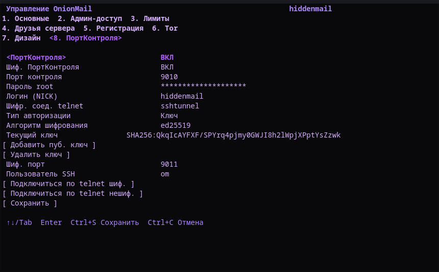
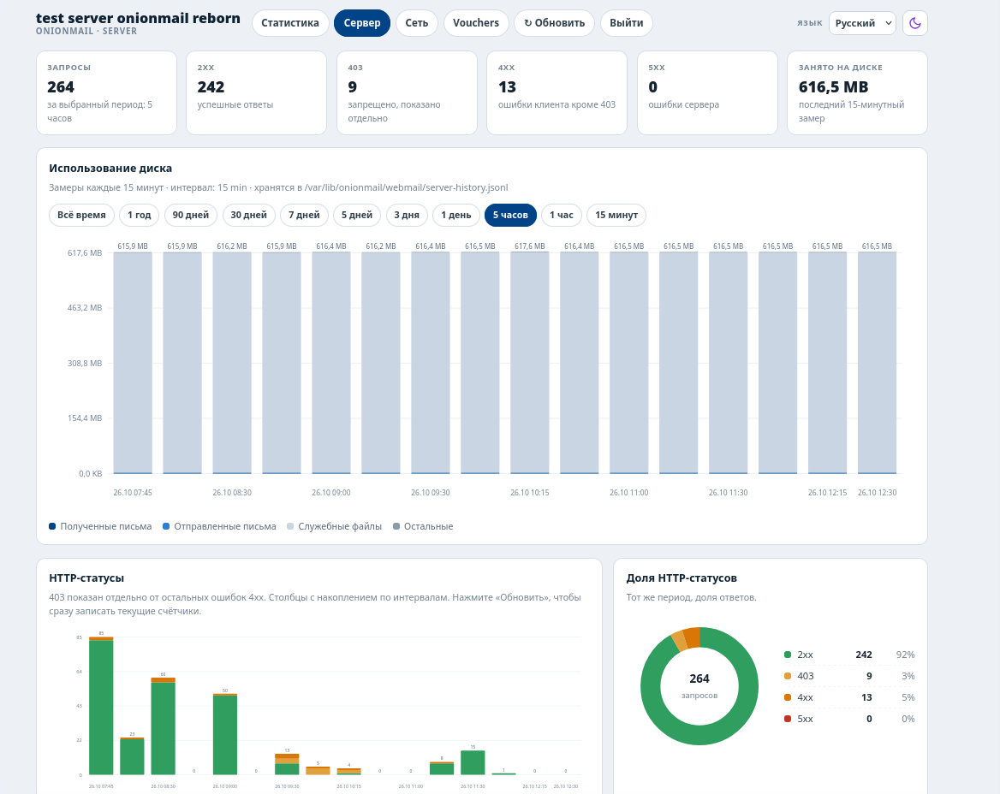
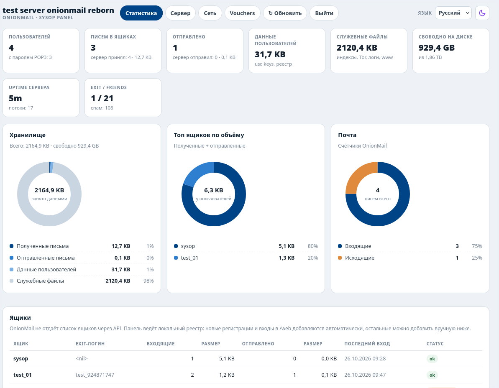

# OnionMail Reborn

Docker-сборка OnionMail 1.12 с улучшенными веб-интерфейсом, админ-панелью,
многоязычным интерфейсом. Версия CLI: `beta 0.4`.
С лицензией GPL-3.0| см. `LICENSE` и `NOTICE`.

## Возможности

- OnionMail SMTP/POP3, встроенный HTTP и Tor daemon.
- Веб-почта `/web`: вход по основному логину + паролям SMTP и POP3.
- поддержка exit-логинов.
- Улучшенная админ  панель `/admin/index.html`: статистика, диаграммы, размеры ящиков , (она read-only редактировать невозможно ничего кроме vouchers)
  реестр пользователей и ручное добавление ящиков.
- Языки интерфейса: English (стандартный), Deutsch, Français, Русский, Español.
  Переключатель `Language` находится в верхнем углу; выбор хранится в cookie.
- Светлая и тёмная темы для встроенных страниц OnionMail, веб-почты и админ-панели.
  Тема по умолчанию задаётся в `om setup` → `7. Design`, а переключатель
  «солнце/луна» рядом с языком сохраняет выбор в браузере.
- Свой логотип: в `7. Design` выберите `Add logo` и укажите путь к PNG/JPG
  внутри контейнера. `Reset logo` возвращает стандартный логотип OnionMail.
  Файл с хоста можно заранее скопировать:
  `docker cp logo.png onionmail:/tmp/logo.png`.
- ПортКонтроля (`om setup` → `8. ControlPort`): включение/выключение,
  , пароль root (S — показать/скрыть), логин (тот же ONIONMAIL_NICK)
  и встроенный telnet-клиент (`Ctrl+A` — помощь, `Ctrl+]` — выход).
- Шифрованный ПортКонтроля (SSH--тунель): ; SSH слушает только `127.0.0.1`. Кнопка
  `Подключиться по telnet шиф.` поднимает SSH-туннель, кнопка
  `Подключиться по telnet нешиф.` открывает обычный telnet
  Пароль SSH — root-пароль ПортКонтроля. После изменения
  в TUI перезапустите контейнер; команды `om controlport ...`
  перезапускают его сами(поэтому сохраните все перед вводом этих команд).
  В разделе также есть `Тип авторизации` (`Password`/`Key`), алгоритм
  ключа, текущий ключ (отпечаток) и добавление/удаление публичного ключа.
  В режиме `Key` пароль отключён, внешние клиенты входят по добавленному
  ключу; в режиме `Password` этот ключ исключается из `authorized_keys`,
  но остаётся сохранённым для обратного переключения. Встроенный клиент
  всегда использует внутренний ключ. Ключи применяются без перезапуска,
  смена типа авторизации/порта/пользователя — после рестарта. Поддерживаются
  ed25519, RSA2048/3072/4096 и ECDSA P-256/P-384/P-521;
  ECDSA-secp256k1/P-192/Curve224  Ручное подключение:
  `ssh -p 9011 -N -L 19010:127.0.0.1:9010 om@127.0.0.1`, затем
  `telnet 127.0.0.1 19010`. Из CLI: `om controlport connect` (обычный
  telnet-клиент) 
- для просмотра команд: `om` или `om help`
- оригинальные команды из OnionMail сохранены

## Быстрый старт

```bash
cp .env.example .env
# укажите параметры в .env под ваш сервер (все это можно указать по docker exec (название контейнера) om setup)
docker compose build
docker compose up -d
```

Проверка:

```bash
docker compose ps
curl -fsS http://127.0.0.1:18000/healthz
```

Для публикации hidden service на хосте (рекомендуется) запустите:

```bash
sudo ./host_tor_setup.sh
```

и укажите полученный `.onion` в `ONION_ADDRESS` в `.env`.

### Локальный доступ без Tor (bridge-сеть)

По умолчанию контейнер использует `network_mode: host` и front слушает
`127.0.0.1:18000`. Если контейнер запущен в обычной bridge-сети, порт нужно
опубликовать, а front — перевести на `0.0.0.0`:

```bash
docker run -d --name om-test \
  -p 127.0.0.1:18000:18000 \
  -e WEB_BIND=0.0.0.0 -e TOR_MODE=off \
  -v om-test-etc:/etc/onionmail \
  -v om-test-lib:/var/lib/onionmail \
  -v om-test-mail:/var/onionmail \
  -v om-test-log:/var/log/onionmail \
  -v om-test-tor:/var/lib/tor \
  onionmail-local:1.12
```

Или используйте готовый override:

```bash
docker compose -f docker-compose.yml -f docker-compose.bridge.yml up -d
```

После этого сайт доступен на `http://127.0.0.1:18000/` (webmail — `/web`).
В bridge-режиме без доступа к Tor контейнер работает локально, без onion.

## Переменные из .env

| Переменная | Назначение |
|---|---|
| `ONIONMAIL_NICK` | Внутреннее имя сервера, по умолчанию |
| `ONIONMAIL_DISPLAY_NAME` | Отображаемое имя сервера |
| `ONION_ADDRESS` | Адрес.onion (обязателен при USE_HOST_TOR=1) |
| `USE_HOST_TOR` | 1 — использовать Tor хоста, 0 — Tor внутри контейнера |
| `TOR_IP`, `TOR_PORT` | SOCKS-прокси Tor |
| `SYSOP_SMTP_PASSWORD`, `SYSOP_POP3_PASSWORD` | Необязательные пароли sysop при первичной генерации |
| `CAPTCHA_DISABLE` | yes не рекомендуется; обычно CAPTCHA включена |

Секреты и пароли не коммитятся: `.env`, `sysop.txt`, `keyblock.txt` и
`registry.json` остаются в Docker-томах/локально.

## Языки

Все пользовательские страницы проекта (`/web`, `/register.html`-надстройки,
`/admin/index.html`) переведены на 5 языков. Встроенные страницы OnionMail
дополнительно переводятся, выбор языка справа сверху
сохраняется для всего сайта.

- English — стандартный
- Deutsch
- Français
- Русский
- Español

## Структура

``` structure
Dockerfile                    сборка образа и бинарных файлов go
docker-compose.yml            запуск контейнера
entrypoint.sh                 инициализация OnionMail, Tor, политик и front
cmd/om/                       CLI: setup, status, version, check, ap, voucher
cmd/front/                    веб-почта, прокси, темы, админ-панель
cmd/voucher/                  CLI выпуска/проверки voucher-кодов
internal/omcore/              конфигурация, состояние и управление OnionMail
internal/front/               сервер веб-интерфейса и страницы
internal/olang/               локализация
internal/omtui/               интерактивное меню setup
languages.json                переводы интерфейса
theme/                        локальные изображения облаков и иконки тем
front.py                      Python front (не используется Docker-сборкой)
host_tor_setup.sh             публикация hidden service на хосте
onionmail_*.deb*              пакет OnionMail и контрольная сумма
.env.example                  шаблон конфигурации
```

## Примечания

Это независимый форк, не связанный с onionmail.info.
проект находится в бете возможны баги

## Скриншоты
--- главный экран ---

--- настройки в tui (фиолетовые)---

--- панель по /admin/server.html

--- панель по /admin/index.html

